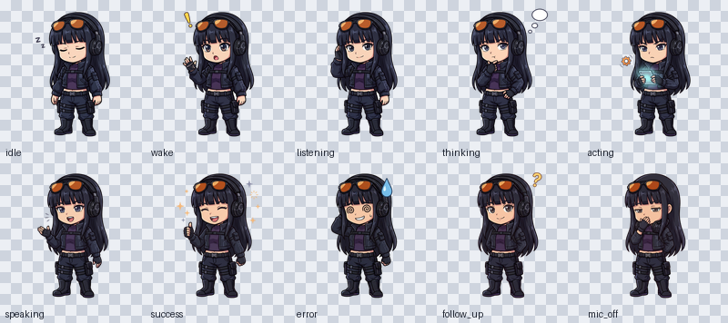
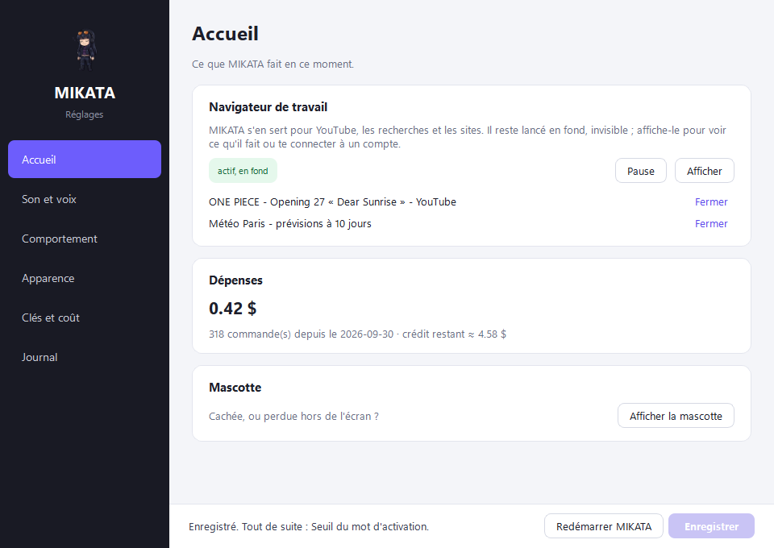

<p align="center">
  
</p>

# MIKATA

A voice assistant for Windows PCs. Say "MIKATA", speak naturally, and she acts on your PC and
answers out loud in your headset.

Listening, transcription and voice run locally: your audio never leaves the PC, only the
transcribed sentence is sent to a cloud LLM, which decides what to answer and what to do.

> **Language**: MIKATA only understands and speaks **French** for now (transcription, prompts,
> voice and interface are set up for French).
>
> **Status**: personal project, development on hold. The code is provided as is.

## What she does

- **Listens all the time at almost no cost**: the wake word is detected on the CPU
  (openWakeWord), with a verifier that recognizes your voice. Ctrl+Alt+M works as a backup.
- **Transcribes locally** with Whisper large-v3-turbo on the GPU, starting at your first pause,
  before she is even sure you have finished speaking.
- **Answers fast**: the voice starts while the model is still writing (Kokoro or Piper locally,
  ElevenLabs as an option).
- **Acts on the PC** with 60+ tools: apps and windows, volume and media, timers and reminders,
  files, clipboard, keyboard and mouse, PowerShell, sleep and shutdown.
- **Drives apps and the web in the background**: reads and clicks through Windows
  accessibility (UI Automation), uses a dedicated, invisible Brave browser, searches the web
  and checks the weather.
- **Learns**: long-term memory, and successful tasks become skills that are replayed later
  without calling the model.
- **Stays careful**: nothing is ever permanently deleted (everything goes to the Recycle Bin),
  files are backed up before being overwritten, and risky actions need a spoken confirmation.
- **Talks naturally**: follow up without saying "MIKATA" again, interrupt her by speaking, stop
  her with "stop".
- **Lives on your desktop** as an animated mascot (customizable skins), with a settings window.

<p align="center">
  
</p>

## Requirements

- Windows 11, a microphone and a headset.
- An NVIDIA graphics card (Whisper on CUDA, about 1.6 GB of video memory). Without one:
  `stt.device: cpu` and `stt.compute_type: int8` in `config.yaml`, slower.
- An API key for an OpenAI-compatible LLM (default model: DeepSeek V4.1 Flash; set
  `llm.base_url` and `llm.model` in `config.yaml` for your provider).
- Optional: [Brave](https://brave.com) for browser automation, a [Tavily](https://app.tavily.com)
  key (free) for web search, an ElevenLabs key for a more natural voice.

A macOS port (Apple Silicon) is included, but the most recent features (app automation,
browser) target Windows.

## Installation

In PowerShell:

```powershell
# 1. uv, the Python manager (reopen PowerShell afterwards)
powershell -ExecutionPolicy ByPass -c "irm https://astral.sh/uv/install.ps1 | iex"

# 2. The code and its dependencies (Python 3.11 is installed if needed)
git clone https://github.com/samysheesh/MIKATA.git
cd MIKATA
uv sync

# 3. Local models, about 2 GB (Whisper, voices, speech detection, wake word)
uv run python scripts\download_models.py

# 4. Keys: fill in at least LLM_API_KEY
Copy-Item .env.example .env
notepad .env
```

Then pick your microphone and headset, and check the configuration:

```powershell
uv run python scripts\list_audio_devices.py   # names to put in audio.input_device / output_device
uv run python -m mikata --check-config        # expect "Configuration valide"
```

All settings live in [`config.yaml`](config.yaml), with comments; the main ones can also be
changed from the settings window.

## Usage

```powershell
uv run python -m mikata
```

The icon shows up in the notification area, along with the mascot. Say **"Hey Jarvis"** (or
press Ctrl+Alt+M), then your request, in French:

- "quelle heure est-il à Tokyo ?" (what time is it in Tokyo?)
- "ouvre Spotify", "mets le volume à 30", "pause" (open Spotify, set the volume to 30, pause)
- "lance le dernier opening de One Piece" (play the latest One Piece opening)
- "mets un minuteur de 10 minutes" (set a 10-minute timer)

Until you train the "MIKATA" wake word on your own voice, "Hey Jarvis" is the wake word. To
train it (about half a day, mostly passive): see [`docs/WAKE_WORD.md`](docs/WAKE_WORD.md). If
it triggers on its own, raise `wake.threshold` in `config.yaml`.

Other useful commands:

```powershell
uv run python -m mikata --ask "quel temps fait-il à Paris ?"   # one question, no microphone
uv run python -m mikata --help                                 # all options

powershell -ExecutionPolicy Bypass -File scripts\install_autostart.ps1 -StartNow   # start with Windows
powershell -ExecutionPolicy Bypass -File scripts\install_desktop_shortcut.ps1      # desktop shortcut
```

Optional: `scripts\install_usn_helper.ps1`, run once as administrator, keeps the file index up
to date for instant file searches ("où est mon CV ?", where is my resume?).

## How it works

```text
mic → wake word       openWakeWord on the CPU, + voice verifier
    → end of speech   Silero VAD
    → transcription   Whisper on the GPU
    → LLM + tools     cloud model; the tools run on the PC
    → spoken answer   Kokoro / Piper locally (or ElevenLabs), streamed to the headset
```

A single Python process built around an `asyncio` loop; heavy work runs in dedicated threads,
and the interface (PySide6) runs in a separate process.

| Folder | Role |
| --- | --- |
| `mikata/audio`, `wake`, `vad`, `stt` | microphone capture, wake word, end of speech, transcription |
| `mikata/llm`, `agent`, `action` | LLM client, agent loop and safety guard, program execution and action policies |
| `mikata/tools`, `mcp` | tools (one tool = one class registered with `@register_tool`), plus external tools over MCP |
| `mikata/uia`, `browser`, `files` | Windows accessibility, browser automation, file index |
| `mikata/learn` | learned skills and lessons drawn from previous turns |
| `mikata/tts`, `ui` | speech synthesis; mascot, settings and tray icon |
| `scripts/`, `mikata/eval` | model download, audio setup, wake word training, benchmarks |

Going further:

- [`docs/ARCHITECTURE.md`](docs/ARCHITECTURE.md): technical choices and latency budget;
- [`docs/AGENT_CORE.md`](docs/AGENT_CORE.md): design of the agent core (programs, action
  policies, learning), with its sources;
- [`docs/MASCOT_SKIN_GUIDE.md`](docs/MASCOT_SKIN_GUIDE.md): create a skin for the mascot.

Code comments, logs and the interface are in French.

## Development

```powershell
uv run ruff check .
uv run ruff format --check .
uv run pytest                              # audio, GPU and Windows APIs are mocked: also runs on Linux
uv run python scripts\eval_bench.py        # benchmark: 50 tasks on a simulated PC, with the real LLM
```

## License

A project by [samysheesh](https://github.com/samysheesh), with the macOS port by
[DevYatsu](https://github.com/DevYatsu). Code under the [Apache-2.0](LICENSE) license (see also
[`NOTICE`](NOTICE)).

The "gars" and "femme" skins are not under an open license (all rights reserved). Downloaded
models keep their own licenses, including the non-commercial "hey_jarvis" model: see
[`THIRD_PARTY.md`](THIRD_PARTY.md).
